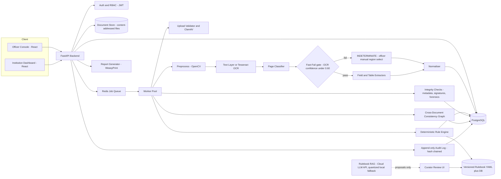
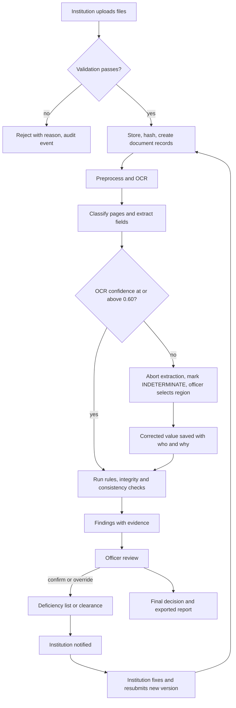
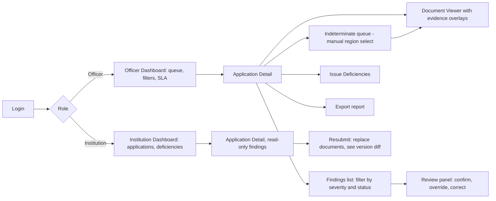

# SIH26261 Implementation Blueprint

*AI-assisted application validation, document authentication and AICTE compliance verification. Design document, no code. All sample data in this document is SYNTHETIC. All numeric thresholds shown are ILLUSTRATIVE unless marked VERIFIED.*

## Feasibility verdict and flagship

**Verdict: feasible as a functional prototype, not as a production government system.** The defensible core is: ingestion, OCR with source-page evidence, deterministic rule checks, cross-document consistency checks, officer review and explainable reports. Architectural-drawing analysis and geospatial checks are partly feasible only under strict conditions (vector PDFs, scale validation, manual confirmation, user-supplied coordinates).

**Flagship innovation (selected): the Cross-Document Consistency Graph.** Every extracted value (land area, institution name, survey number, faculty names, audited figures, built-up area) becomes a node tied to a document, page and bounding box. Edges connect values that should agree across documents (deed vs plan vs application form; affidavit vs faculty list). Contradictions become evidence-linked findings. It needs no fraud dataset, no proprietary database and no black-box model, so it is explainable and testable.

**Verified regulatory context (checked on 21 Oct 2026):**

- The governing document for 2026-27 is the AICTE Approval Process Handbook (APH) 2024-25 to 2026-27 together with amendments issued from time to time (AICTE public notice for Approval Process 2026-27; portal opened 28 Nov 2025, with NSWS referenced for universities).
- AICTE issued a corrigendum on 2 Dec 2025 modifying the definitions of Expert Visit Committee and Standing Appellate Committee (reported by TeamLease RegTech).
- A Careers360 report on the 2026-27 update says it raises supernumerary seat caps by discipline and level (earlier a single 15% slab) and requires nil deficiency based on self-disclosure. This is a secondary source; confirm against the handbook.
- **NOT verified by me:** any numeric faculty ratio, cadre proportion, area norm or financial threshold. I could not read the handbook clauses themselves. The team must download the handbook and amendments from aicte.gov.in and enter each rule with its clause number. Until then, every number in this document is a placeholder.

## 1. Problem decomposition

**Personas**

- **Scrutiny Officer:** reviews many applications, needs fast, evidence-backed deficiency lists, wants to overrule the system with a recorded reason.
- **Institution Admin:** submits documents, needs clear deficiency messages and a simple resubmission path.
- **Senior Reviewer/Approver:** signs off on verdicts, needs summaries and an audit trail.
- **Rulebook Curator (admin):** maintains versioned rules; approves rule changes.
- **System Auditor:** read-only access to audit events.

**Core workflow:** institution uploads application and documents, system classifies and extracts, rule engine evaluates, integrity and consistency checks run, officer reviews findings against evidence, deficiencies are issued, institution resubmits a new version, officer records the decision, report is exported.

**Pain points addressed:** manual reading of long scanned documents; inconsistent application of norms; no traceability from verdict to evidence; repeated deficiency cycles; undetected cross-document mismatches.

**Constraints:** small student team, free and open-source tools, no proprietary AICTE data, no cadastral or satellite APIs, limited GPU, a few weeks of build time.

**Measurable success criteria (targets to measure, not claims):**

- Every finding links to rule ID, clause, document, page and bounding box (target 100%).
- Field-level extraction accuracy measured on your own labelled set (report per field).
- Rule engine passes 100% of hand-written unit tests for each rule.
- Planted inconsistencies in the demo set detected, with false-positive count reported honestly.
- Officer can resolve a finding in under 3 clicks from the findings list.

## 2. Feasibility audit

| Feature | Class | Notes |
| --- | --- | --- |
| Multi-format ingestion (PDF, TIFF, PNG, JPEG) | Essential | Validate by magic bytes, not extension |
| OCR with evidence boxes | Essential | Native PDF text first, OCR fallback |
| Document classification | Essential | Keyword and layout rules, small classifier as upgrade |
| Table extraction | Feasible enhancement | Reliable on text PDFs, fragile on scans; manual correction required |
| Deterministic compliance engine | Essential | The heart of the product |
| Cross-document consistency checks | Essential (flagship) | Normalisation and fuzzy matching |
| Metadata analysis | Feasible enhancement | Indicator only |
| Digital signature verification | Feasible enhancement | Works only for signed PDFs; use pyHanko |
| Officer console, institution dashboard | Essential |  |
| Resubmission with version diff | Essential |  |
| Explainable PDF/JSON report | Essential |  |
| Versioned rulebook with RAG-assisted proposals | Feasible enhancement | Proposals only, human approval mandatory |
| Drawing analysis on vector PDFs | Research-heavy | Demo on 2 or 3 synthetic CAD-exported plans |
| Drawing analysis on arbitrary scans | Out of scope | Offer manual annotation instead |
| Geospatial cross-check | Research-heavy | Replace with user-supplied coordinates and OpenStreetMap sanity check |
| Satellite imagery building-area estimation | Out of scope | No lawful accessible data, high error |
| ML forgery detection / tamper score | Out of scope as proof | No labelled data; use as weak indicator at most |
| Fully automated approval or rejection | Out of scope | Decisions stay with officers |

**Misleading or technically weak ideas to avoid**

- Claiming a document is forged because of an ELA or metadata anomaly. Re-saved and scanned documents trigger these routinely.
- Claiming precise measurements from scanned plans without scale calibration.
- Letting an LLM read the rulebook and directly apply rules at decision time.
- Quoting accuracy percentages without a labelled test set.
- Calling a prototype production-ready or integrating with government systems you cannot access.

## 3. Recommended MVP

**Scope: one program type (for example undergraduate engineering, extension of approval), one academic year (2026-27), four document types, six rules.**

1. Institution uploads: application data form (structured), faculty list (table), audited financial statement (text PDF), land deed or lease (scan), building plan (vector PDF), faculty affidavit.
2. Pipeline extracts: land area, built-up area, faculty counts by cadre, student intake, audited corpus or surplus figure, institution name and survey number.
3. Engine evaluates six rules: faculty-student ratio, cadre distribution, built-up area vs intake, land area, financial threshold, document completeness. Numbers come from the handbook once you verify them.
4. Consistency graph checks: institution name across all documents, land area (deed vs application vs plan), faculty names (affidavit vs list), built-up area (plan vs application).
5. Officer reviews findings with highlighted evidence, confirms, overrides or requests correction, issues deficiencies.
6. Institution resubmits; system shows a version diff and re-runs only affected checks.
7. PDF report is exported with the full evidence trail.

This proves value end to end on real files, and every piece is testable.

## 4. System architecture



## 5. Data-flow diagrams



**Failed extraction handling:** extraction never silently guesses. A field whose OCR confidence is below the Fast-Fail threshold (default 0.60) is aborted immediately and marked INDETERMINATE; a field that passes the gate but fails validation (for example a negative area) is flagged for review. Any rule depending on an INDETERMINATE field returns INDETERMINATE (not PASS or FAIL), and the officer resolves it by drawing a bounding box on the page (see the Fast-Fail OCR circuit in section 10).

**Resubmission:** a resubmission creates a new application version. Unchanged documents are matched by SHA-256 and reused. Only rules whose inputs changed are re-run, and the UI shows a diff of findings between versions.

## 6. Module design

| Module | Responsibility | Inputs / outputs | Errors | Difficulty |
| --- | --- | --- | --- | --- |
| Ingestion | Validate, scan, store, hash | file in, document record out | reject, quarantine | Low |
| Preprocessing | Deskew, denoise, binarise, DPI normalise | images in, cleaned pages out | fall back to original | Medium |
| OCR/text | Native text else Tesseract, with word boxes | page in, tokens with boxes and confidence | Fast-Fail abort below 0.60, INDETERMINATE | Medium |
| Classifier | Assign document and page types | text and layout features in, label and score | UNKNOWN goes to officer | Medium |
| Extractors | Regex, table and anchor-based field extraction | tokens in, typed candidate fields | candidate with confidence | High |
| Normaliser | Units (sq m, sq ft, acre), dates, names, currency | raw string in, typed value and unit | validation failure flag | Medium |
| Rule engine | Evaluate versioned rules over typed facts | facts and rulebook version in, findings | INDETERMINATE | Medium |
| Integrity | Metadata, signature, forensic indicators | file in, indicator list | tool failure recorded | Medium |
| Consistency graph | Match entities and values across documents | facts in, mismatch findings | low-similarity flagged | Medium-High |
| Review service | Confirm, override, correct, comment | officer action in, immutable record | version conflict | Low |
| Reporting | Render evidence-linked report | findings in, PDF and JSON | template error | Low |
| Audit | Append hash-chained events | event in, chained record | write failure blocks action | Low |
| Rulebook RAG | Propose rule drafts from official text | PDF in, draft rules with citations | proposals only | High |

## 7. Technology stack (decisions)

| Layer | Choice | Why | Rejected |
| --- | --- | --- | --- |
| Frontend | React + Vite + TypeScript, PDF.js for viewing | Overlay boxes on pages easily | Streamlit (weak for review workflow) |
| Backend | FastAPI (Python 3.11) | Typed, async, shares code with ML | Django (heavier) |
| Queue | Redis + RQ | Minimal setup | Celery (more config) |
| Database | PostgreSQL 16, SQLAlchemy, Alembic | Relational integrity, JSONB for facts | SQLite (concurrency) |
| Storage | Local content-addressed filesystem behind an interface; MinIO optional | Simplest, swappable | Cloud buckets (cost) |
| PDF parsing | PyMuPDF (text, boxes, vector paths), pdfplumber for tables | Fast, gives coordinates | PyPDF2 |
| OCR | Tesseract 5 with OpenCV preprocessing | Stable, offline, word boxes | PaddleOCR (heavier install; optional upgrade) |
| Table extraction | pdfplumber on text PDFs, OCR-row clustering on scans | Predictable | Deep table models (GPU, fragile) |
| Signatures | pyHanko | Open-source PDF signature validation | Custom crypto |
| Malware scan | ClamAV in Docker | Free | None |
| Fuzzy matching | RapidFuzz | Fast, simple | Embedding models |
| LLM for RAG proposals (offloaded) | Cloud LLM API (Gemini, Groq or Claude) behind a provider interface; offline fallback: 4-bit quantized Phi-3 Mini or Qwen 1.5B | No local RAM cost on a 16 GB machine; free tiers are enough for batch clause processing | Local 7B model (out-of-memory risk next to PostgreSQL, OpenCV and workers) |
| Reports | WeasyPrint (HTML to PDF) | Easy templating | ReportLab |
| Auth | JWT, argon2 hashing, RBAC in FastAPI | Simple and sound | Third-party IdP |
| Deployment | Docker Compose on one VM or laptop | Reproducible demo | Kubernetes |

### Hardware and memory budget (16 GB demo machine)

The design target is that the core services (FastAPI, PostgreSQL, Redis, OCR workers, frontend) stay stable for a live demo. The figures below are planning estimates only; measure them with `docker stats` during week 1 and adjust.

| Component | Planning budget (GB, to be measured) | Control |
| --- | --- | --- |
| Operating system, browser, screen recording | 4 to 5 | Close other applications during the demo |
| PostgreSQL | 0.5 to 1 | Small shared\_buffers, one database |
| FastAPI app | 0.5 to 1 | Two uvicorn workers at most |
| OCR/CV workers | 1.5 to 3 | Two worker processes at most, one page at a time, 300 DPI cap, no GPU models |
| Redis | under 0.3 | Maxmemory set |
| ClamAV daemon | 1 to 1.5 | Run only if needed; pre-scan demo files and use on-demand scanning during the demo |
| Frontend dev server | 0.5 | Serve the production build during the demo |
| LLM | 0 by default (cloud API) | Quantized fallback only in its own memory-limited container (about 1 to 3 GB) |

Every container gets a `mem_limit`, so an overrun kills the offending container instead of the database. Large TIFFs are processed page by page and never loaded whole.

## 8. Database design

Primary keys are UUIDs. Key relations are listed per table.

- **users**(id, name, email, password\_hash, role, institution\_id FK nullable, active)
- **institutions**(id, name, aicte\_id\_text, state, type)
- **applications**(id, institution\_id FK, academic\_year, program\_type, category, current\_version\_no, status)
- **application\_versions**(id, application\_id FK, version\_no, submitted\_at, submitted\_by FK users, rulebook\_version\_id FK, status; unique(application\_id, version\_no))
- **documents**(id, version\_id FK, doc\_type, original\_name, mime, sha256, storage\_key, page\_count, scan\_status)
- **pages**(id, document\_id FK, page\_no, page\_class, class\_confidence, dpi, ocr\_engine)
- **tokens**(id, page\_id FK, text, x0, y0, x1, y1, confidence) (optional, can be JSONB per page)
- **extracted\_fields**(id, version\_id FK, field\_key, raw\_value, normalised\_value JSONB, unit, confidence, page\_id FK, bbox JSONB, extractor, status \[AUTO, MANUAL, INDETERMINATE\], fail\_reason nullable, corrected\_by FK nullable)
- **rulebooks**(id, name, authority, academic\_year, source\_document, source\_sha256)
- **rulebook\_versions**(id, rulebook\_id FK, version\_label, status \[DRAFT, APPROVED, PUBLISHED, RETIRED\], approved\_by FK, published\_at, content\_sha256)
- **rules**(id, rulebook\_version\_id FK, rule\_key, title, clause\_ref, source\_page, severity, applicability JSONB, definition JSONB, verified boolean)
- **verification\_runs**(id, version\_id FK, rulebook\_version\_id FK, started\_at, engine\_version)
- **verification\_results**(id, run\_id FK, rule\_id FK, status \[PASS, FAIL, INDETERMINATE, NOT\_APPLICABLE\], required\_value, observed\_value, explanation, confidence)
- **evidence\_refs**(id, result\_id FK, field\_id FK, page\_id FK, bbox JSONB, snippet)
- **integrity\_findings**(id, document\_id FK, check\_type, indicator, severity, detail JSONB, is\_proof boolean default false)
- **consistency\_edges**(id, version\_id FK, field\_a FK, field\_b FK, relation, similarity, status)
- **review\_decisions**(id, result\_id FK, reviewer\_id FK users, action \[CONFIRM, OVERRIDE, REQUEST\_CORRECTION\], reason, created\_at)
- **deficiencies**(id, version\_id FK, result\_id FK, text, due\_date, resolved\_in\_version\_id FK nullable)
- **audit\_events**(id bigserial, actor\_id, action, object\_type, object\_id, payload JSONB, prev\_hash, event\_hash, created\_at)

**Immutability:** audit\_events and review\_decisions have no UPDATE or DELETE grants for the application role; a database trigger rejects them. Each audit event hash = SHA-256(prev\_hash + canonical payload).

## 9. Compliance engine design

**Principle:** rules are data, evaluated by plain deterministic code. No LLM at evaluation time.

**Statuses:** PASS, FAIL, INDETERMINATE (missing or low-confidence input), NOT\_APPLICABLE. **Severity:** CRITICAL (blocks approval), MAJOR, MINOR, ADVISORY.

**Example rule definition (ILLUSTRATIVE values, not from the handbook):**

```yaml
rule_key: FAC_RATIO_UG_ENGG
title: Faculty to student ratio
clause_ref: APH 2024-27, <clause to be filled after verification>
verified: false
severity: CRITICAL
applicability:
  academic_year: 2026-27
  program_level: UG
  institution_type: [Private, Government]
inputs:
  total_faculty: {type: int, min_confidence: 0.85}
  sanctioned_intake_total: {type: int, min_confidence: 0.85}
check:
  fn: ratio_at_least
  params: {numerator: total_faculty, denominator: sanctioned_intake_total, minimum: 0.0667}
explain: Required ratio {minimum}; found {observed}.
tests:
  - {inputs: {total_faculty: 100, sanctioned_intake_total: 1200}, expect: PASS}
  - {inputs: {total_faculty: 50, sanctioned_intake_total: 1200}, expect: FAIL}
  - {inputs: {total_faculty: null, sanctioned_intake_total: 1200}, expect: INDETERMINATE}
override: {allowed: true, requires_reason: true, role: SENIOR_REVIEWER}
```

**Mechanics:** a registry of typed, pure Python functions (ratio\_at\_least, sum\_at\_least, area\_at\_least, value\_equals\_within\_tolerance, set\_complete); rules reference function names and parameters only. Rule files are validated against a JSON schema on load; each version is hashed; verification runs store the rulebook version used, so any verdict is reproducible.

**Deterministic vs probabilistic:** deterministic = rule evaluation, unit conversion, consistency tolerances, signature validation result. Probabilistic = OCR, classification, extraction, fuzzy name match, forensic indicators. Probabilistic outputs only feed rules as typed facts with confidence; below threshold they yield INDETERMINATE and go to a human.

**Human override:** an officer can confirm, override (reason mandatory, recorded, never deletes the original result) or correct an extracted value (re-runs dependent rules). Overrides of CRITICAL rules need Senior Reviewer role.

## 10. OCR and document understanding

1. **Format handling:** detect type by magic bytes. PDFs: try the native text layer per page (PyMuPDF); if fewer than a minimum number of characters, rasterise at 300 DPI and OCR. TIFF multipage is split into pages.
2. **Preprocessing (images only):** grayscale, deskew (Hough or minimum-area rectangle), denoise, adaptive threshold, border removal. Keep the original page image; store the transform so boxes map back to the original.
3. **Page classification:** stage one uses keyword and layout rules (for example 'sale deed', 'registrar', 'balance sheet', 'affidavit', 'no objection', sheet-title blocks on plans). Stage two is an optional TF-IDF plus logistic regression model trained on your labelled synthetic and public samples. Unknown pages go to the officer.
4. **Extraction:** per document type, a small set of extractors: anchor-text plus regex (for example 'Total Built-up Area' followed by a number), table parsers, and key-value form parsers. An optional LLM call (cloud API, or the quantized fallback) may suggest a value, but never for a fast-failed field, only if its output is validated against a schema AND the quoted evidence string is found verbatim in the page tokens; otherwise it is discarded.
5. **Normalisation:** convert sq ft, sq m, acres, hectares, guntha and similar into one canonical unit; Indian digit grouping (1,00,000); dates to ISO; names lower-cased with titles and punctuation stripped; currency to rupees with the stated unit (lakh, crore) preserved in the raw value.
6. **Confidence:** field confidence = min(OCR word confidence, pattern-match strength, validation pass). The hard gate is the Fast-Fail circuit below: under 0.60 there is no automated extraction. From 0.60 to 0.90 the value is accepted but flagged for officer attention; at or above 0.90 it is auto-accepted. Treat all three cut-offs as starting points to tune on your labelled set.
7. **Source references:** every field stores page\_id and bounding box; the viewer draws it.
8. **Manual correction:** officer sees the crop and the extracted value, edits, and saves; the correction stores old value, new value, user and reason, and triggers re-evaluation of dependent rules.

### Fast-Fail OCR circuit

**Purpose:** stop spending compute, and stop risking silent errors, on regions that OCR cannot read reliably. A low-quality field is never parsed; it goes straight to a person.

1. **Scope:** the gate runs per field and per table, not per document, so one blurry page does not stall the rest of the application. Fields read from a native PDF text layer skip the gate (they are not OCR output).
2. **Score:** field confidence is the mean Tesseract word confidence over the field's region (0 to 100, shown as 0 to 1). For tables, each row is scored and the table fails if any required cell is below the threshold or if more than a set share of cells is, as configured per table type.
3. **Threshold:** default 0.60, stored in configuration per field type (stricter for CRITICAL-rule inputs if the data supports it), never hard-coded. Tesseract confidences are not calibrated probabilities, so 0.60 is a routing cut-off to validate, not a measure of correctness.
4. **On failure, abort immediately:** no retry with other settings, no second OCR engine, no regex salvage, no LLM call. The field is stored as INDETERMINATE with reason FAST\_FAIL\_OCR, the measured confidence, the page, and a suggested region if a layout anchor was found.
5. **Propagation:** every rule that needs the field returns INDETERMINATE; the application can never be marked clear while a CRITICAL rule is INDETERMINATE. Other fields and documents continue through the pipeline.
6. **Manual routing:** the field appears in the officer's Indeterminate queue, ordered by the severity of the dependent rule. The officer opens the page, draws a bounding box on the value, and types or confirms it. An optional assist re-runs OCR on that box only (cropped, upscaled) to prefill the text; the officer still confirms it.
7. **Record:** the saved value has source MANUAL, the officer's box, user, timestamp and reason; dependent rules re-run automatically; an audit event is written.
8. **Cheap pre-flight (optional):** before full OCR, estimate page blur (variance of the Laplacian) and effective DPI; pages that are clearly unreadable are flagged at once, saving even the OCR pass.
9. **Metrics:** report the Fast-Fail rate per document type, manual resolution time, and, from a labelled run with the gate disabled, how many fast-failed fields would actually have been read correctly (the cost of the gate). Use these to choose the threshold.

The region-select tool is a page of the officer console (PDF.js page with a drawable rectangle overlay).

## 11. Blueprint vision

**Honest position:** reliable measurement from arbitrary scanned plans is not achievable in a student prototype. Use a tiered approach.

- **Tier 1 (build): vector PDFs exported from CAD.** PyMuPDF exposes lines, rectangles and text with coordinates. Read the title-block scale (for example 1:100) and any dimension text; validate scale by checking a labelled dimension against the measured drawn length. If they disagree beyond a tolerance, mark scale UNVERIFIED and disable area computation.
- **Tier 2 (build, small): label-based checks.** OCR or text-layer search for room labels (classroom, laboratory, library, staircase, ramp, lift, fire exit, toilet) and tabulated area statements. Compare the plan's own area table to the application form (consistency graph). This is robust and demonstrable.
- **Tier 3 (stretch): geometry from vector PDFs.** Closed polygons of rooms near labels; compute area only when scale is verified; count exits and stairs as labelled symbols.
- **Tier 4 (manual confirmation):** for scans, the officer clicks to place a scale bar and polygon; the system computes from the calibrated pixels. This is human-measured, system-assisted, and labelled so in reports.

**Do not** train a detector for ramps or exits (no dataset), and do not output areas from scans without a validated scale. Accessibility checks (ramp presence, slope notation) stay as label detection plus officer confirmation. Any numeric norms (for example minimum corridor widths) must come from the verified handbook or building code, not from this document.

## 12. Authenticity and fraud checks

| Check | Can establish | Cannot establish |
| --- | --- | --- |
| PDF metadata (creator, producer, dates) | Document was produced or modified by certain software; dates inconsistent with claimed date | That it is forged; scanners and editors rewrite metadata legitimately |
| Digital signature (pyHanko) | Document bytes unchanged since signing; signer certificate details; whether signing time and certificate validity are consistent | Real-world identity beyond the certificate; trust of the chain unless a trust store is configured; revocation status offline |
| Revocation (OCSP/CRL) | Status only if network access and responder reachable | Status at the original signing time without embedded or timestamped data |
| Image forensics (ELA, noise, copy-move) | Regions with different compression history or duplicated patches, as an indicator | Forgery. JPEG recompression, screenshots and scans cause false positives |
| Cross-document consistency | Contradictions between documents, impossible values, reused identifiers | Which document is the false one |
| Duplicate detection (hash, perceptual hash) | Same file or near-identical pages reused across institutions or years | Intent |

**Policy:** each integrity finding has a type, plain-language indicator, severity capped at MAJOR, and the field is\_proof = false. Wording in the UI: 'Needs verification', never 'forged'. Signature results use exact categories: VALID\_INTACT, VALID\_UNTRUSTED\_CHAIN, MODIFIED\_AFTER\_SIGNING, INVALID, NO\_SIGNATURE, REVOCATION\_UNKNOWN. A document with no signature is not suspicious by itself. Final authenticity decisions are made by officers through registrar or issuing-authority verification outside the system.

## 13. Regulatory RAG

**Purpose:** speed up rulebook maintenance, never replace it.

1. **Ingest official PDFs only** (handbook, amendments, corrigenda downloaded from aicte.gov.in), store the SHA-256 and source URL, mark the academic year.
2. **Segment into clauses** using heading and numbering patterns; keep page and bounding box per clause.
3. **Index** with BM25 plus small local embeddings (for example a multilingual MiniLM) in pgvector or FAISS.
4. **Propose rules:** the LLM (cloud API by default, see the hosting note below) receives one clause and the rule JSON schema and must return a draft rule with the exact quoted source sentence. A validator rejects drafts whose quote is not found verbatim in the clause or whose numbers do not appear in the quote.
5. **Curator review UI:** shows clause text beside the draft; curator edits, adds unit tests, and approves or rejects. Drafts have verified = false until a human ticks it.
6. **Regression test:** run the full rule test suite plus a set of golden applications against the new version; show which verdicts changed.
7. **Controlled publication:** APPROVED to PUBLISHED needs a second approver (four-eyes) and writes an audit event. Published versions are immutable; changes create a new version. Applications keep pointing to the version they were evaluated under.
8. **Corrigenda:** treated as new source documents that produce a new draft version with a diff against the previous one (for example the 2 Dec 2025 corrigendum).

**LLM hosting for the RAG workflow (16 GB constraint):**

- **Default: cloud API.** A thin `LLMProvider` interface (propose\_rule(clause) returning a draft) is implemented for Gemini, Groq and Claude; one is selected by configuration. This removes the LLM from the local memory budget.
- **Data rule:** only public, official regulatory text is sent. Applicant documents, faculty names and any personal data are never sent to the API. Keys live in environment variables.
- **Off the critical path:** proposals are a curator activity, not part of upload-to-verdict. Generate and cache proposals before the demo so the live demo does not depend on network or rate limits.
- **Correctness does not depend on the provider:** the verbatim-quote validator, curator approval and regression tests apply identically to every provider.
- **Offline fallback:** if the event strictly requires 100% local execution, set `OFFLINE_ONLY=true`. The provider switches to a 4-bit quantized micro-model (Phi-3 Mini or Qwen 1.5B) served by llama.cpp or Ollama in its own container with a memory limit, one request at a time and a capped context length. A 7B model is deliberately not used, since it risks out-of-memory crashes that would take down the FastAPI, PostgreSQL and OpenCV core. Expect more rejected drafts from a micro-model; the validator discards them and the curator can enter rules by hand.

## 14. Security and privacy

**Threat model (STRIDE summary)**

- Spoofing: weak login, token theft. Controls: argon2, short-lived JWT plus refresh, optional TOTP for officers.
- Tampering: altered results or audit trail. Controls: hash-chained audit log, no update or delete permissions, hash of rulebook per run.
- Repudiation: officer denies a decision. Control: signed audit events with user, time, and IP.
- Information disclosure: cross-institution access. Control: row-level checks on institution\_id in every query, tests for IDOR.
- Denial of service: huge or malicious files. Controls: size limit, page limit, decompression-bomb check, worker timeouts and memory limits.
- Elevation: role escalation. Control: server-side RBAC only.

**RBAC:** Institution Admin (own applications), Scrutiny Officer (assigned applications), Senior Reviewer (override CRITICAL, approve), Curator (rulebook), Auditor (read-only audit), System Admin (users, no review rights).

**Upload safety:** allow-list of PDF, TIFF, PNG, JPEG; verify magic bytes; reject encrypted PDFs or request a password flow; strip active content (JavaScript, embedded files) from the rendered copy; ClamAV scan; store with random names outside the web root; process in a sandboxed worker container with no network.

**Encryption and secrets:** TLS in transit; encrypted disk or application-level encryption at rest; secrets in environment variables or Docker secrets, never in the repo; separate database roles.

**Retention and backups:** retention periods set by policy (placeholder, to be defined with the authority); nightly pg\_dump plus file store backup, restore tested once before the demo. Personal data (faculty names, ID numbers) minimised and masked in logs. Note: handling real personal data in India falls under the Digital Personal Data Protection Act, 2023; use synthetic data for the prototype and have the organisers or a lawyer confirm obligations for any real deployment (not verified here).

## 15. Sample explainable report (SYNTHETIC)

| Field | Value |
| --- | --- |
| Application | APP-2026-0042, version 2 |
| Rulebook version | DEMO-RB-0.3 (illustrative values, verified = false) |
| Rule ID | FAC\_RATIO\_UG\_ENGG |
| Clause | APH 2024-27, clause to be confirmed |
| Required | Ratio at least 0.0667 (illustrative) |
| Extracted | 58 faculty / 1200 intake = 0.0483 |
| Evidence | Faculty list, document D-17, page 3, table row totals (bbox 112,640,498,672); Application form D-02 page 1 intake field |
| Extraction confidence | 0.93 (faculty count), 0.97 (intake) |
| Status | FAIL, severity CRITICAL |
| System explanation | Faculty count is below the required ratio for the stated intake |
| Reviewer action | CONFIRM by Officer R. Rao (synthetic), comment 'Faculty list checked manually', deficiency issued, due in 15 days |

**Consistency finding example:** 'Land area in sale deed (2.10 acres, D-05 p2) differs from application form (3.00 acres, D-02 p1). Similarity: values differ by 43%. Status: MAJOR, needs verification.'

## 16. UI/UX blueprint



**Application detail wireframe (low fidelity):**

```
+--------------------------------------------------------------+
| APP-2026-0042 v2 | Status: Under Review | Rulebook DEMO-0.3  |
+----------------------+---------------------------------------+
| Findings             |  Document viewer (PDF.js)             |
| [FAIL] FAC_RATIO     |  page 3 / 12   [zoom] [prev] [next]   |
| [WARN] LAND_MISMATCH |  +---------------------------------+  |
| [PASS] BUILTUP_AREA  |  |  table...  [highlighted bbox]   |  |
| [INDET] FIN_CORPUS   |  +---------------------------------+  |
|                      |  Extracted: 58  conf 0.93  [Edit]     |
+----------------------+---------------------------------------+
| Review: [Confirm] [Override + reason] [Request correction]   |
+--------------------------------------------------------------+
```

Institution view shows the same findings in plain language with the exact document and page to fix, a checklist of open deficiencies, and a 'Resubmit' button that diffs against the last version. Export offers PDF and JSON.

## 17. API contract

All endpoints require a bearer token; JSON responses; errors use `{code, message, details}`.

- `POST /api/v1/applications` creates an application. Body: `{institution_id, academic_year, program_type, category}`. Returns `{application_id, version_id, version_no}`.
- `POST /api/v1/applications/{id}/versions/{vno}/documents` multipart upload with `doc_type`. Returns `{document_id, sha256, scan_status: QUEUED}`.
- `POST /api/v1/applications/{id}/versions/{vno}/verify` starts a run. Body: `{rulebook_version_id}` (optional, default published). Returns `{run_id, status: QUEUED}`.
- `GET /api/v1/runs/{run_id}` returns `{status, progress, counts: {pass, fail, indeterminate}}`.
- `GET /api/v1/applications/{id}/versions/{vno}/findings?severity=CRITICAL&status=FAIL` returns:

```json
{"findings": [{"result_id": "r-901", "rule_id": "FAC_RATIO_UG_ENGG", "clause_ref": "APH 2024-27 cl. TBD", "status": "FAIL", "severity": "CRITICAL", "required": 0.0667, "observed": 0.0483, "confidence": 0.93, "explanation": "...", "evidence": [{"document_id": "D-17", "page": 3, "bbox": [112,640,498,672], "snippet": "Total faculty 58"}]}]}
```

- `PATCH /api/v1/fields/{field_id}` corrects a value. Body: `{value, unit, reason}`. Returns updated field and the list of re-evaluated rules. For fast-failed fields, \`GET /api/v1/queue/indeterminate\` lists the queue and \`POST /api/v1/fields/{field\_id}/manual\` saves a manual entry with \`{page, bbox, value, unit, reason}\`.
- `POST /api/v1/results/{result_id}/review` Body: `{action: CONFIRM|OVERRIDE|REQUEST_CORRECTION, reason}`. Returns the review decision record.
- `POST /api/v1/applications/{id}/deficiencies` Body: `{result_ids: [], due_days}`. Returns deficiency records and sets status to DEFICIENCY\_ISSUED.
- `PATCH /api/v1/applications/{id}/status` Body: `{status, reason}`; allowed transitions are enforced server-side (DRAFT, SUBMITTED, UNDER\_REVIEW, DEFICIENCY\_ISSUED, RESUBMITTED, RECOMMENDED, REJECTED\_RECOMMENDED).
- `GET /api/v1/applications/{id}/versions/{vno}/report?format=pdf|json` returns the export.
- `POST /api/v1/rulebooks/{id}/versions` and `POST /api/v1/rulebook-versions/{id}/publish` for curators.

## 18. Testing and evaluation

- **Unit:** each rule function with boundary tests (exactly at threshold, just below, missing input); normaliser for units and Indian number formats; hash chain verification.
- **Integration:** upload to report for each demo application; resubmission diff; RBAC matrix (every role against every endpoint).
- **OCR accuracy:** character and word error rate on a hand-transcribed set of your own pages, reported per scan quality bucket. Report your numbers, not borrowed ones. Also sweep the Fast-Fail threshold (for example 0.50 to 0.80) on the labelled set and report, per threshold, the share of fields routed to manual and the share of auto-extracted fields that are wrong; choose the default from that curve.
- **Field extraction:** precision, recall and exact-match per field type against labels; plus the fraction of fields routed to review.
- **Classification:** confusion matrix on labelled pages.
- **Compliance correctness:** every rule has at least one pass, fail and indeterminate test; a reviewer other than the author checks rule-to-clause mapping.
- **Consistency/integrity:** planted-inconsistency detection rate and false-positive count on clean documents.
- **Security:** upload fuzzing (renamed executables, zip bombs, encrypted PDFs), IDOR tests, dependency scan, authentication tests.
- **Usability:** task-based test with 3 to 5 volunteers (time to resolve a deficiency, errors), plus a short questionnaire.
- State the sample size with every metric; with small sets, say results are indicative only.

## 19. Demonstration plan (all documents SYNTHETIC, labelled in a footer watermark)

**Scenario:** fictional 'Sunrise Institute of Technology, Demo City' applies for extension of approval (UG engineering).

**Planted issues, with expected findings:**

1. Faculty list totals 58 against intake 1200: ratio rule FAIL (CRITICAL).
2. Sale deed shows 2.10 acres, application says 3.00 acres: land mismatch (MAJOR).
3. Institution name differs slightly in the audited statement ('Sunrise Inst. of Tech.'): fuzzy match passes with note (ADVISORY).
4. Affidavit lists a faculty member absent from the faculty list: set mismatch (MAJOR).
5. Plan area table totals 18,000 sq m vs application 24,000 sq m: built-up mismatch (MAJOR).
6. One bank-statement PDF edited with a different producer than the rest: integrity indicator (MINOR, needs verification).
7. One scanned page is blurry: field fast-fails (OCR confidence under 0.60), is marked INDETERMINATE and routed to the officer's manual region select, and the dependent rule stays INDETERMINATE until resolved.
8. A digitally signed PDF (self-generated test certificate) modified after signing: MODIFIED\_AFTER\_SIGNING.

**Flow (about 6 minutes):** institution uploads, pipeline runs, officer opens findings, clicks a finding to see highlighted evidence, corrects the blurry field, overrides one finding with a reason, issues deficiencies; institution fixes the faculty list and resubmits; version diff shows finding 1 now PASS; report exported; audit log shown with hash-chain verify button. Also demo a rulebook change: publish a new version and show the regression diff.

## 20. Innovative differentiators

| Idea | Novelty | Feasibility | Demo impact | Judge appeal |
| --- | --- | --- | --- | --- |
| A. Cross-Document Consistency Graph with evidence-linked contradictions | 4 | 5 | 5 | 5 |
| B. Rule-version impact simulator (re-run past applications on a draft rulebook, show verdicts that flip) | 4 | 4 | 4 | 5 |
| C. Scale-validated vector plan analyzer with self-check against labelled dimensions | 5 | 2 | 4 | 4 |

(Scores 1 to 5, my judgement.) **Flagship: A.** It is implementable in the time available, needs no unavailable data, and visualises well as a graph where red edges link conflicting evidence. B is a cheap add-on once rule versioning exists. C is a stretch goal only if Tiers 1 and 2 of section 11 are done.

## 21. Team and timeline

**Roles (3 people)**

- **Person 1 (Backend and rules):** FastAPI, database, auth, audit log, rule engine, rulebook versioning, reports.
- **Person 2 (Document AI):** ingestion, preprocessing, OCR, classifiers, extractors, normaliser, consistency graph, integrity checks.
- **Person 3 (Frontend and QA):** React app, PDF viewer with overlays, dashboards, test data creation, evaluation and demo script.

**Phases (adapt to your actual deadline; durations are proposals)**

1. **Week 1:** verify handbook rules and clause numbers; create synthetic dataset; repo, Docker Compose, schema, auth. Dependency: rules verified before rule coding.
2. **Week 2:** ingestion and OCR pipeline; rule engine skeleton with 3 rules; viewer with static bounding boxes.
3. **Week 3:** extractors for 4 document types; all 6 rules; findings UI; review actions.
4. **Week 4:** consistency graph; integrity checks; resubmission and diff; report export.
5. **Week 5:** rulebook RAG draft flow (only if earlier phases are done); plan analysis Tier 1 and 2; evaluation on labelled set.
6. **Week 6:** hardening, security tests, demo rehearsals, slides, backup demo video.

**Fallbacks:** if OCR quality is poor, the Fast-Fail gate routes those fields to manual region select and the rest of the demo uses text PDFs; if the cloud LLM API is unreachable or rate-limited, serve cached proposals; if the event requires fully offline execution, switch to the quantized micro-model; if that also fails, rule proposals become a manual curator form with clause search; if signature tooling fails, show metadata indicators only and state the limitation; if the plan analyzer is unreliable, use label and table checks only; if live deployment fails, run from a pre-recorded video plus local Docker.

## 22. Risks and limitations

| Risk | Mitigation |
| --- | --- |
| Misreading regulations or using outdated rules | Rules tied to verified clause, version and year; curator review; clear 'unverified' flag |
| No real documents or labelled fraud data | Synthetic documents, public specimen documents with permission; do not claim fraud-detection accuracy |
| OCR errors on poor scans | Fast-Fail OCR gate (default 0.60), INDETERMINATE state, manual region select |
| Legal and privacy concerns with real data | Synthetic data only in prototype; ask organisers about data handling; minimise logs |
| Over-trust in AI by officers | UI wording, mandatory human decision, indicators not verdicts |
| Integration with government systems impossible | Clean REST APIs and import/export; state this as future work |
| Scope creep | Freeze the MVP; stretch goals only after acceptance criteria are met |
| Deployment failure on demo day | Docker Compose with per-container memory limits, cached LLM proposals, offline-capable core, backup video |
| Prototype mistaken for production system | State plainly: not security-audited, not certified, not integrated, no real approvals |

## 23. Final architecture blueprint

**Stack:** React + Vite + TypeScript, PDF.js; FastAPI; PostgreSQL; Redis + RQ; PyMuPDF, pdfplumber, OpenCV, Tesseract; pyHanko; RapidFuzz; ClamAV; WeasyPrint; cloud LLM API for RAG proposals only (quantized Phi-3 Mini or Qwen 1.5B as the offline fallback); Docker Compose with memory limits.

**Repository structure:**

```
sih26261/
  backend/app/{api,auth,models,schemas,services}
  backend/app/pipeline/{ingest,preprocess,ocr,classify,extract,normalise}
  backend/app/engine/{registry,evaluator,loader}
  backend/app/integrity/  backend/app/consistency/  backend/app/reports/
  rulebooks/{2026-27}/*.yaml  rulebooks/tests/
  rag/{ingest,segment,propose}
  frontend/src/{pages,components,viewer}
  data/synthetic/  eval/{labels,scripts}
  docs/{architecture,threat-model,demo-script}
  docker-compose.yml  Makefile
```

**Implementation sequence:** schema and auth, ingestion, OCR with boxes, rule engine with tests, findings API, viewer with overlays, extractors, review actions, consistency graph, resubmission diff, reports, integrity checks, rulebook workflow, plan Tier 1 and 2, evaluation, hardening.

**Acceptance criteria:**

- End-to-end run on the synthetic scenario produces all eight planted findings (or documents why not).
- Every finding shows rule, clause, required, observed, evidence box, confidence, status.
- No rule result depends on an LLM; rulebook versions are immutable and referenced by each run.
- Overrides and corrections are recorded with user and reason; audit chain verifies.
- RBAC and upload-safety tests pass; no cross-institution access.
- Measured OCR and extraction metrics reported with sample sizes, including the Fast-Fail rate; no field below the threshold is ever auto-extracted.
- README states clearly that this is a functional prototype, not a production government system.

**Sources to read before coding:** AICTE Approval Process Handbook 2024-25 to 2026-27 and all amendments and corrigenda (aicte.gov.in); AICTE public notice for Approval Process 2026-27; pyHanko, PyMuPDF and Tesseract documentation.
